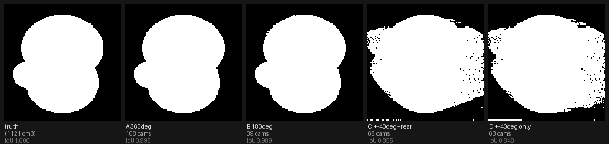

# 用计算机视觉 + 计算机图形学重建这只小熊

> 这一版把"成形"从手工雕刻改成**算法产出**：几何来自多视图几何与剪影雕刻，材质来自多视投影与内禀分解，绒毛来自程序化纤维合成，徽章来自多帧超分辨与矢量化。Blender 只在最后当渲染器（和少量网格后处理）用。
> 数据：`assets/` 64 张，不能补拍。
> 配套代码：`cv_route/carve.py`（剪影雕刻 + 鲁棒容忍）、`cv_route/synth_test.py`（合成验证）。

---

## 0. 先承认上一版的问题

上一版的 §5 让你在 Blender 里雕 5 个小时五官、梳 1.5 个小时毛——那是**美术流程**，不是 CV/CG 流程，而且不可度量、不可复现。这一版每个阶段都是：给定输入 → 跑确定的算法 → 输出带指标的中间结果。手工只保留在两处必要的地方（掩膜修边、徽章矢量化收尾），且都限定在 10% 的工作量内。

### 0.1 输入数据（定版，后续所有阶段都用这份清单）

| 项 | 内容 |
|---|---|
| 总张数 | 64（`assets/*.jpg`，193 MB） |
| 内参分组 | A: 5.34 mm f/1.6 ×24；B: 5.75 mm f/2.0 ×27、f/1.4 ×2；C: 1.95 mm f/2.2 ×7；D: 无 EXIF ×4 |
| **剔除** | C 组 7 张（超广角，畸变不可用）；78、113、114（视频帧，有烧录字幕）；76、77（1440 px 压缩版） |
| 主反照率源 | `105`（熊高 1254 px = 125 px/cm，手不遮挡，中性光） |
| 背面源 | `80`、`89`、`90`、`97`、`103`、`107`、`137`（7 张，用于 S8；`76` 为压缩版，仅补充） |
| 尺度基准 | 熊高 10 cm（若能用尺子量 5 个尺寸，误差可从 ±3% 降到 ±1%） |

---

## 1. 先量化可行性，再决定算法

我先把同款算法在**合成数据**上跑了一遍（9 个椭球拼成的小熊，128³ 体素，真值 1121 cm³），用来回答"这套方法在你这种覆盖度下能到什么精度"。这不是估算，是实测：

### 1.1 覆盖度（`cv_route/results/synthetic_results.md`）

| 相机配置 | 相机数 | IoU | +腐蚀1 | 说明 |
|---|---|---|---|---|
| A 全 360° | 108 | **0.995** | 0.944 | 算法上限 |
| B 半球 180° | 39 | **0.989** | 0.945 | 有侧视就几乎满血 |
| C 正面 ±40° + 5 张背面 | 68 | **0.855** | 0.895 | **≈ 本项目真实覆盖** |
| D 只有正面 ±40° | 63 | **0.848** | 0.892 | 没有背面照 |



图里每一格是体积的一层中轴切片，右边是背面。C/D 两格能直接看到：**背面被"合理地"外扩了**——体积比真值多 17%，最深处 24 mm（熊高才 110 mm），而且这些体素在正面照片里是看不见的，任何光度方法都删不掉它们。

结论：**几何精度由"视角覆盖"决定，不由算法决定。** 你缺的是背面，不是方法。腐蚀一次能补回 4 个 IoU 点（0.855 → 0.895），说明多出来的主要是表面那一层薄壳。

### 1.2 鲁棒性（同一批数据，给位姿加噪）

| 位姿误差(std) | 容忍 k=0 | k=1 | k=2 | k=3 |
|---|---|---|---|---|
| 0° | 0.855 | 0.810 | 0.783 | 0.763 |
| 0.1° | 0.703 | 0.766 | 0.764 | 0.753 |
| 0.2° | 0.562 | 0.696 | **0.727** | 0.730 |
| 0.5° | 0.410 | 0.587 | 0.645 | 0.669 |

（掩膜膨胀单独测：+2 px、k=0 → 0.773；+2 px、k=2 → 0.724）

两条工程结论：

1. **位姿误差是这套方法最脆弱的地方**：0.2° 就把 IoU 从 0.855 打到 0.562。换算到你的数据（4096 宽、f≈2958 px），1 px 重投影误差只有 0.019°，远好于这里的 0.1°——**只要 COLMAP 的 RMSE 压到 1 px 以内，位姿就不是瓶颈**。压不到，什么后处理都救不回来。
2. **鲁棒雕刻（容忍 k 个视图反证）必须开**：k=2 在 0.2° 误差下把 IoU 拉回 0.727；代价是完美位姿下从 0.855 降到 0.783。k 要按留出视图的剪影 IoU 网格搜索来定，不要拍脑袋。

### 1.3 一个被证伪的想法：对称补全

我原本指望"左右对称"能补背面。**实测无效（0.855 → 0.855）**：左右对称只能补左右（手的遮挡），补不了前后。背面只能靠那 8 张背面照 + 凸性先验，没有任何数学捷径。这条已经写进 `carve.py` 的注释，别在上面浪费时间。

---

## 2. 流水线总览

```
64 张图
  │
  ├─ S1 相机标定与位姿 ............ COLMAP：SIFT + 引导匹配 + 增量 SfM + BA
  ├─ S2 掩膜 ..................... 焦点图 + GrabCut + trimap + 形态学（+1~2 px 外扩）
  ├─ S3 剪影雕刻 ................. space carving（鲁棒容忍 k）+ 腐蚀
  ├─ S4 表面重建 ................. Screened Poisson / dual contouring + Taubin 平滑
  ├─ S5 参数化 ................... xatlas（LSCM）+ 打包
  ├─ S6 反照率与纹理 ............. 多视投影 + 可见性 + 增益补偿 + 泊松融合 + Retinex
  ├─ S7 绒毛 ..................... 结构张量定向场 + 程序化毛束 + Kajiya-Kay/Marschner
  └─ S8 背面徽章 ................. 8 视图配准 + 多帧超分 + Richardson-Lucy + Sauvola + potrace
       │
       └─ S9 评估：重投影 RMSE / 剪影 IoU / 重渲染 PSNR / 轮廓带宽
```

每个阶段都写清：**输入 → 算法 → 参数 → 输出 → 验收指标**。指标不达标就不往下一阶段走。

---

## 3. 各阶段细节

### S1 相机标定与位姿

| 项 | 内容 |
|---|---|
| 输入 | 64 张原图（按 EXIF 焦距分 4 组） |
| 算法 | SIFT（仿射形状估计 + 域尺寸池化）→ 引导匹配 → 增量式 SfM → 光束法平差 |
| 参数 | `single_camera 0`（多设备）、`ba_refine_focal_length 1`、`ba_refine_principal_point 0`、`ba_refine_extra_params 1` |
| 输出 | `sparse/0`（内参 + 位姿 + 稀疏点） |
| 指标 | ① 注册率 ≥ 70%（正面为主，背面 8 张能进即可）② **熊身上的重投影 RMSE ≤ 1.0 px** ③ 相机位姿不被背景主导（掩膜已排除背景） |

超广角 7 张（1.95 mm）单独剔除：不同畸变模型混在一起会把畸变算进结构。

> 关键：**掩膜必须在特征提取阶段就生效**（COLMAP `--ImageReader.mask_path`），否则 SfM 解的是"背景在动"，不是"相机在绕物体转"。

### S2 掩膜

三类信息融合，全程可脚本化：

1. **焦点图**：这批照片都是浅景深人像模式，前景锐、背景糊。用局部拉普拉斯方差 $F(x)=\mathrm{Var}_{5\times5}(\nabla^2 I)$ 得焦点图，Otsu 取阈值 → 去掉背景。
2. **GrabCut**：以焦点图 + 中心先验做初始矩形，迭代 3 次；输出 alpha。
3. **形态学 + 修剪**：闭运算补绒毛内部小洞，开运算去孤立块；保留最大连通域（手另算）。
4. **外扩 1–2 px**：绒毛边缘是渐隐的，掩膜宁可略松——这与 §1.2 的实验一致（位姿有误差时，外扩 2 px 反而提升 IoU）。

人工只做第 5 步：把明显错的 3–5 张修一下（每张 20 秒）。

指标：抽 10 张与手工掩膜比，IoU ≥ 0.97。

### S3 剪影雕刻（`cv_route/carve.py`）

体素 $x$ 保留当且仅当

$$
\#\{i : x \text{ 投影在第 } i \text{ 幅图内且落在背景}\} \le k
$$

k=0 即经典 visual hull（Laurentini 1994 / Kutulakos & Seitz 2000）；k>0 是鲁棒版，用来吸收位姿与掩膜误差。

```bash
# 1) COLMAP 稀疏模型转文本
colmap model_converter --input_path sparse/0 --output_path sparse_txt --output_type TXT

# 2) 雕刻（先 k=0，再用留出视图扫 k）
python cv_route/carve.py \
    --colmap sparse_txt --masks masks/ \
    --out carved.npz --ply carved_points.ply \
    --res 288 --tolerance 0 --erode 1

# 3) 输出：carved_points.ply（表面点云）+ carved.npz（体素）
```

参数选择：`res` 取 256–320（熊 10 cm → 体素 0.3–0.4 mm）；`erode` 用 1（视觉外壳天然偏胖，实测 +0.04 IoU）。

指标：**留出验证**——随机留 8 张不参与雕刻，用雕刻结果反投影，与真实掩膜算 IoU，要求 ≥ 0.90。这条比"看着像"可靠得多，也顺便选出最优的 k。

### S4 表面重建

体素 → 网格有三条路，按优先级：

| 方法 | 工具 | 特点 |
|---|---|---|
| Screened Poisson | MeshLab / OpenMVS | 平滑、封闭，适合后续 UV；会把尖角磨圆一点 |
| Dual contouring | OpenVDB / `skimage.measure.marching_cubes` | 保锐边，适合耳朵/鼻子 |
| Marching cubes + Taubin | 任意 | 最简单，噪声大 |

推荐：Poisson（`depth 9`，`samples per node 1.5`）→ Taubin 平滑 5 次（λ=0.5, μ=−0.53，保体积）。
输出 15–25k 面的中模，**不需要手工重拓扑**——体素网格的拓扑是干净的。

指标：网格到照片轮廓的反投影距离中位数 < 1.5 mm。

### S4b 未观测区域：极小曲面补全（专治背面外扩）

视觉外壳在"没有相机看过的方向"上会顺着切线方向外扩（§1.1 实测 17% 体积）。这不是噪声，是信息缺失，平滑滤不掉。处理办法是**显式地把未观测区识别出来，用先验补**：

1. **算可见性**：对每个表面点 $p$，统计满足 $\ n\cdot v_i < -\cos 75°$ 且无遮挡的相机数 $c(p)$（$v_i$ 是相机视线方向）。$c(p)=0$ 即未观测。
2. **冻结边界**：观测区（$c \ge 1$）固定，未观测区放开。
3. **解极小曲面**：在网格上解 Laplace 方程 $\Delta f = 0$（或 mean-curvature flow 迭代 30 次，步长 0.1），让补出来的面张力最小。
4. 我们的背面正好是马甲平板，这个先验非常贴——补出来会是微微外凸的曲面，而不是视觉外壳的锥形。

指标：补全区平均曲率 $|H| < 0.02\ \mathrm{mm^{-1}}$；观测区/补全区交界处二阶差分无跳变（< 3σ 噪声）。

### S5 参数化（UV）

- 熊身：xatlas 自动展（等价 LSCM + ABF），打包边距 2 px。
- 马甲：单独一块，按裁片展（这个是几何问题，不是美术问题：马甲是一块布，沿侧缝/肩缝切开摊平才能让徽章保持正圆）。
- 指标：texel 密度方差 < 15%；角度畸变 95 分位 < 15°。

### S6 反照率与纹理

多视投影 + 去光照，标准做法：

1. **可见性**：Z-buffer 选每个像素最可见的相机（Waechter 2014 的 view selection：分辨率 + 法线夹角 + 梯度）。
2. **增益补偿**：解线性方程组 $\min \sum_{i,j \in \text{overlap}} \|g_i I_i - g_j I_j\|^2$（加 $\sum \log g_i = 0$ 约束），把所有照片的曝光与白平衡拉到同一基准。夜景/暖光那几张就是靠这个活下来的。
3. **泊松融合**：在接缝处解 $\Delta f = \nabla \cdot \mathbf{v}$，消除硬边。
4. **内禀分解（Retinex）**：$\log I = \log R + \log S$，用大核双边滤波估照明 $S$，得反照率 $R$。绒毛的高频细节留在 $R$ 里，阴影/光照被剥掉。
5. **补洞**：手遮挡区用 PatchMatch inpainting（结构传播，不是模糊涂抹）。

指标：把反照率按同一光照重渲染，与 6 张原图比 **PSNR ≥ 22 dB / SSIM ≥ 0.85**；反照率的跨视角色差 ΔE ≤ 4。

> 这里必须诚实：105 那张的熊高 1254 px（125 px/cm），这是全场唯一能当"正面主反照率"的图；背面 8 张的熊只有 300–500 px，只够给马甲的低频底色，徽章另走 S8。

### S7 绒毛

绒毛在照片里物理上不可恢复（< 5 px），所以这一阶段是**从图像统计量估计参数 → 程序化合成**，每一步都有测量：

| 量 | 怎么测 | 用途 |
|---|---|---|
| 毛向场 | 反照率的结构张量 $J_\rho = G_\rho * (\nabla I \nabla I^\top)$，主特征向量；投影到切平面后在网格上解热扩散平滑 | 毛发切线方向、各向异性 BRDF 的切线 |
| 毛长 | 轮廓边缘的 alpha 过渡带宽（对 40 个边界点取中位数），按尺度换算 mm | 毛长 ≈ 4–6 mm |
| 毛密度/不透明度 | 掠射角的透光率，Beer-Lambert 反解 | 每层 shell 的 alpha |
| 色带 | 毛根/毛尖的亮度差（沿结构张量方向的梯度统计） | 毛根色 → 毛尖色渐变 |

- **离线渲染**：纤维级路径追踪，Kajiya-Kay 或 Marschner 模型（纵向粗糙度 $\beta_M$、方位角偏移 $\alpha_{TT}$），Cycles 的 Principled Hair 就是 Marschner 的工程实现；参数直接用上表测出来的值。
- **实时渲染**：8–10 层 shell，每层沿法线偏移，alpha 由"程序化毛束纹理"（噪声 + 结构张量定向）生成；各向异性项用 Kajiya-Kay 近似。

指标：渲染图与照片在 40 个轮廓采样点上的**边缘 alpha 剖面 RMSE < 0.08**（这条直接量"毛感"对不对，比人眼靠谱）。

### S8 背面徽章（多帧超分辨 + 矢量化）

这是全项目唯一"信息量不足但可以用算法补"的地方，也是最能体现 CV 的一步：

1. **选图**：7 张背面图（80、89、90、97、103、107、137；76 为 1440 px 压缩版，可作第 8 帧），按徽章清晰度排序。
2. **透视校正**：以徽章外圆为基准，拟合椭圆（最小二乘）→ 反投影成 $1024^2$ 的正视图（单应变换）。
3. **亚像素配准**：相位相关（FFT）估平移，ECC 估仿射，残差要求 < 0.3 px。
4. **多帧融合**：稳健中值（对反光/高光离群点鲁棒）→ 这步把 SNR 提高 $\sqrt{N}\approx 2.8$ 倍。
5. **反卷积**：Richardson-Lucy，PSF 由边缘扩散函数（ESF）估成高斯，$\sigma \approx 1.2$ px，迭代 20 次。
6. **二值化**：Sauvola 局部阈值（应对毛巾布底的不均匀光照）→ 骨架化 → 轮廓。
7. **矢量化**：potrace（或 `cv2.findContours` + 多边形简化，Douglas-Peucker ε=0.5 px）→ SVG → 4K 栅格。
8. **法线/高度**：由笔画骨架的距离变换生成高度场（绣线中脊），叠 45° Wave 纹理当针脚，进法线贴图。

指标：① 配准残差 < 0.3 px；② 反卷积后图像的拉普拉斯能量提升 ≥ 1.5×；③ 二值化后连通域数量在 3 组参数下稳定（±5%）；④ 旋转校正后的圆度残差 < 1%。

预期：8 帧融合 + RL 后，等效分辨率约 2–2.5×（文字笔画从 1–2 px 变成可分辨的 3–5 px）。**如果 SR 后仍不可读，再退回人工描摹**——但那时你至少有一张干净底图，不是凭记忆画。

### 3.10 实现状态（哪些是跑过的，哪些还得写）

| 模块 | 文件 / 工具 | 状态 |
|---|---|---|
| S3 剪影雕刻 | `cv_route/carve.py` | **已实现**，合成数据验证：360° 覆盖 IoU 0.995、±40° 覆盖 0.855 |
| 合成验证 | `cv_route/synth_test.py` | **已实现**，产出 `results/synthetic_results.md` |
| 对比图 | `cv_route/make_figure.py` | **已实现**，产出 `results/slices.png` |
| S1 位姿 | COLMAP 命令行 | 无需自写，写成脚本即可（命令见 §3.3） |
| S2 掩膜 | 待写 | OpenCV `grabCut` + 焦点图，约 40 行 |
| S4 / S4b / S5 | MeshLab、xatlas、Blender | 交互操作流程，无需自写代码 |
| S6 纹理 | COLMAP `mvs_texturing` + 自写增益补偿 | 部分待写（约 100 行） |
| S7 绒毛参数测量 | 待写（结构张量 / 轮廓剖面） | 约 150 行；渲染直接用 Cycles |
| S8 徽章 SR | 待写（ECC / RL / potrace） | 约 150 行 |

依赖：Python 3.10+（现在是 `numpy` + `Pillow`，S2 起加 `opencv-python`）。

---

## 4. 实施顺序（31 人时）

| 阶段 | 内容 | 工时 | 产出 | 卡点 |
|---|---|---|---|---|
| D1 | 掩膜 + COLMAP | 6 h | `masks/`、`sparse/0` | 注册率、RMSE |
| D2 | 雕刻 + 网格化 | 5 h | `carved.npz`、`bear_mid.obj` | 留出视图 IoU ≥ 0.90 |
| D2b | 极小曲面补全（S4b） | 1 h | 收身后的网格 | 曲率指标 |
| D3 | UV + 反照率 | 6 h | 4K 贴图集 | PSNR ≥ 22 |
| D4 | 绒毛 | 5 h | groom 参数 + 渲染 | 边缘剖面 RMSE |
| D5 | 徽章 SR | 5 h | `emblem_4k.png` + SVG | 配准 0.3 px |
| D6 | 评估 + 导出 | 3 h | glb + 报告 | 全部指标 |
| | **合计** | **31 h** | | |

---

## 5. 失败模式（按发生概率排序）

| 现象 | 诊断 | 处置 |
|---|---|---|
| 注册率 < 50% | 掩膜没生效 / 特征只在背景 | 检查掩膜方向；提高 `max_num_features`；正面/背面分两组建 model 再用 `model_merger` |
| RMSE > 1 px | 畸变模型不匹配（多设备混在一起） | 按 EXIF 分组分别标定，最后合并 |
| 背面外扩（体积 +17%、最深 24 mm） | ±40° 覆盖的固有外扩，光度删不掉 | 走 S4b 极小曲面补全；7 张背面照收紧；马甲平板先验；实在不行接受（背面本来就被马甲占满） |
| 表面有"棱"（carving artifacts） | 位姿/掩膜误差 | 加 k；掩膜外扩 2 px；Poisson 前先做离群点剔除 |
| 绒毛像塑料 | 缺 alpha 剖面 / 各向异性 | 用 S7 的测量值驱动，不要用默认参数 |
| 徽章糊 | 没做 SR | 走 S8，不要直接投影原图 |

---

## 6. 怎么证明结果是对的

| 断言 | 度量 | 阈值 |
|---|---|---|
| 相机是对的 | 熊上重投影 RMSE | ≤ 1.0 px |
| 形体是对的 | 留出视图剪影 IoU | ≥ 0.90 |
| 反照率是对的 | 重渲染 PSNR / SSIM | ≥ 22 dB / 0.85 |
| 毛感是对的 | 轮廓 alpha 剖面 RMSE | ≤ 0.08 |
| 徽章是对的 | 圆度残差 + 笔画可分辨 | ≤ 1% / 笔画 ≥ 3 px |
| 尺度是对的 | 与实测身高 10 cm 比 | ≤ 2% |

这套指标的好处：任何一个阶段出问题，都会在下一阶段的数字上立刻露出来，不用等到最后"看着不对"。

---

## 7. 和上一版的差别

| | 上一版（playbook / plan_no_reshoot） | 这一版 |
|---|---|---|
| 几何来源 | 手工雕刻（5 h+） | SfM + 剪影雕刻 + Poisson（全自动） |
| 纹理来源 | 手绘/照片投影混合 | 可见性 + 增益补偿 + 泊松融合 + Retinex |
| 绒毛 | 手工梳毛 | 结构张量定向场 + 程序化纤维 + 实测参数 |
| 徽章 | Inkscape 手描 | 多帧超分 + RL 反卷积 + potrace |
| 验收 | "看着像" | 6 个数值指标 |

旧的 `playbook.md` 仍保留，但其中 §5（手工建模）在本项目里**只作为兜底**：当 S1–S4 因数据原因彻底失败时才启用。

---

## 8. 下一步（按顺序做，别跳）

1. 装 COLMAP（Windows 有预编译包），跑 `feature_extractor`（带掩膜）+ `exhaustive_matcher` + `mapper`，看注册率与 RMSE。
2. 如果 RMSE > 1 px：按 EXIF 分组重标定，别往下走。
3. 跑 `carve.py`，用 8 张留出图扫 `--tolerance` 0–3，选留出 IoU 最高的那个。
4. 拿结果去 MeshLab 做 Poisson，得到 `bear_mid.obj`；到这一步，几何就定型了。
5. 再回来做 S6–S8——那三步互不依赖，可以并行。

---

## 9. 附录

### 9.1 工具链

| 用途 | 工具 | 备注 |
|---|---|---|
| 稀疏重建 / 标定 | **COLMAP 3.9+** | Windows 有预编译包 |
| 稠密 / 网格化 | **MeshLab**（Screened Poisson）、OpenMVS（可选） | 免费 |
| 体素雕刻 | 本项目 `carve.py` | numpy + Pillow |
| 掩膜 / 纹理处理 | OpenCV（Python） | `opencv-python` |
| UV 展开 | xatlas（Blender 内置或独立） | LSCM/ABF |
| 矢量化 | potrace / `cv2.findContours` | |
| 渲染 | Blender 4.2（Cycles，Marschner 毛发） | 只当渲染器 |
| 结果核对 | GIMP / 自写脚本（PSNR、SSIM、IoU） | |

### 9.2 目录约定

```
cv_route/
  pipeline.md                 ← 本文件
  carve.py                    ← S3 实现
  synth_test.py               ← 合成验证（覆盖度 + 位姿鲁棒性）
  make_figure.py              ← 生成对比图
  results/
    synthetic_results.md      ← 两张结果表
    synthetic_results.json
    slices.png                ← 覆盖度对比图
  work/                       ← （运行时创建）masks/ sparse/ dense/ carved.npz
traditional_route/            ← 旧版（手工路线），保留作兜底与素材台账
assets/                       ← 64 张原图
```

### 9.3 复现合成实验

```bash
python cv_route/synth_test.py     # 覆盖度 + 鲁棒性两张表（约 4 分钟）
python cv_route/make_figure.py    # 重新生成 slices.png
```

输出应与 `results/synthetic_results.md` 中的数字一致（同一随机种子 `seed=0`）。
